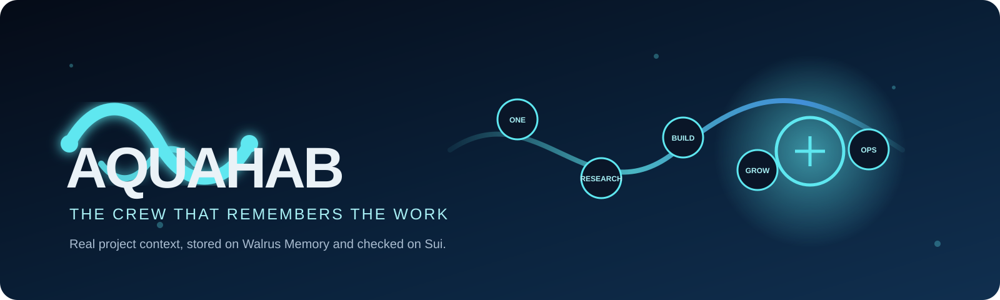
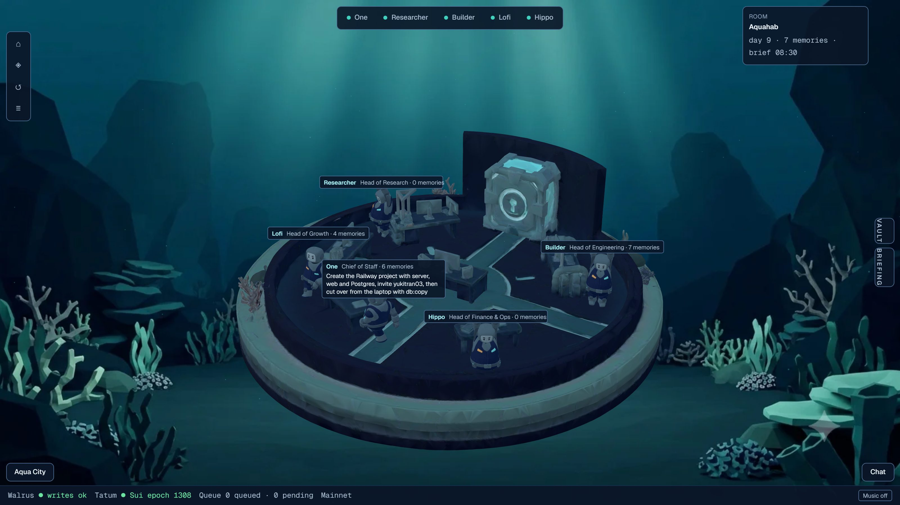
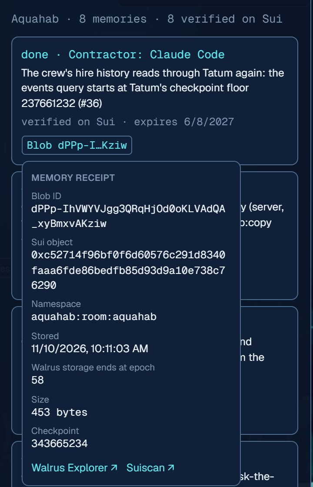
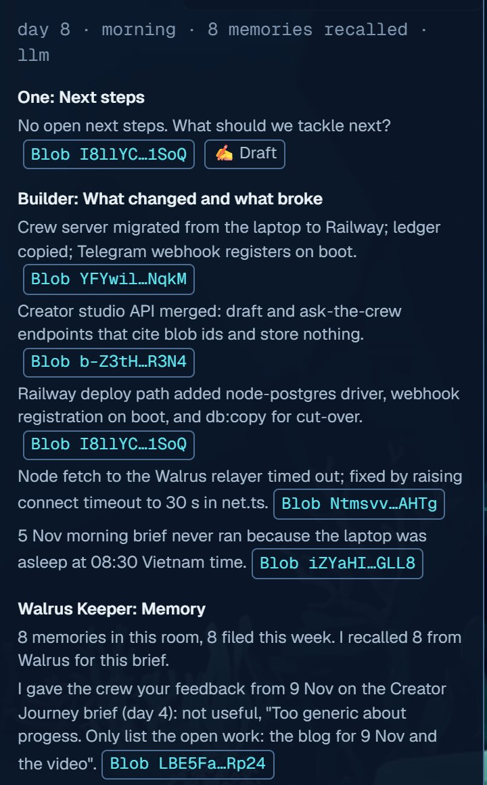

<p align="center">
  <a href="https://aquahab.up.railway.app">
    
  </a>
</p>

<p align="center">
  <a href="https://aquahab.up.railway.app"></a>
  <a href="https://recall-tatum-walrus.vercel.app/"></a>
  <a href="https://aquahab.up.railway.app/api/proof"></a>
  <a href="https://aquahab.up.railway.app/api/crew"></a>
  <a href=".github/workflows/ci.yml"></a>
</p>

<h3 align="center">An AI crew for each real project. It keeps the project's memory on Walrus,<br />and every line it writes links to the memory it came from.</h3>

<p align="center"><b><a href="https://aquahab.up.railway.app">Open the live office →</a></b></p>

<p align="center">
  <a href="https://aquahab.up.railway.app"></a>
</p>

## In 30 seconds

A CEO runs each project with a crew of AI agents: **One** (Chief of Staff), **Researcher**, **Builder**, **Lofi** (Growth), **Hippo** (Finance) and the **Walrus Keeper**. Every morning the crew writes a brief. Every evening it asks how the day went. What the CEO keeps is stored as a Walrus memory, and the next brief is written from those memories.

- **Memory changes the next output.** Every brief line cites the Walrus Blob it rests on. A line that cites nothing real is dropped before anyone sees it.
- **Every memory has a receipt on Sui.** Click any Blob badge to see its Sui object, namespace, author key, checkpoint and storage end epoch, read through Tatum.
- **Every agent is an on-chain identity.** Each crew member signs with its own delegate key on one MemWal account. The roster and its hire history come from Sui, not from our database.
- **Feedback is memory too.** A 👎 with a one-line reason becomes a memory. Later briefs follow it and say so, with its receipt.
- **In daily use on mainnet since 4 Nov.** As of 11 Nov there are 20 memories in 4 namespaces, each matched to its Blob on Sui. There are 7 hires on chain, one of them Claude Code as a contractor with its own key.

## See it

| Every memory has a receipt | Every brief line cites its memory |
|:---:|:---:|
|  |  |
| A memory signed by the Claude Code contractor's own key. The receipt is read from Sui through Tatum. | Each line carries the Blob it came from. The Keeper's last line is the CEO's 👎 from another day, with its receipt. |

## Verify it in two minutes

| Check | Open | What you should see |
|---|---|---|
| **The product** | [Live office](https://aquahab.up.railway.app) | Pick a room. Open **VAULT** for memories and receipts, open **BRIEFING** for cited lines, then click any **Blob** badge. Reads are public; writes need the CEO's Telegram session. |
| **Memory matches the chain** | [`/api/proof`](https://aquahab.up.railway.app/api/proof) | `memories` equals `onChain`, per namespace and per crew member. |
| **The crew comes from Sui** | [`/api/crew`](https://aquahab.up.railway.app/api/crew) | `source: "tatum-grpc"`. `history` lists every hire with its transaction, read through Tatum GraphQL. |
| **The service is live** | [`/api/health`](https://aquahab.up.railway.app/api/health) | Mainnet mode, relayer writes `ok`, and Tatum's Sui epoch and checkpoint. |
| **One Blob on chain** | [Suiscan](https://suiscan.xyz/mainnet/object/0x3d5f8a2498136fa3a0d5b0d6972f50e81d97c67e97dbaddfaab1c5d921d8a12a) · [Walruscan](https://walruscan.com/mainnet/blob/FxSi7LLYAEQ4-kLZxG7PE37tYq1mGiC1qeZt23PwJS0) | The first memory. Its metadata records the room namespace and the key of the agent that filed it. |
| **Every criterion** | [`docs/TOTAL_RECALL.md`](docs/TOTAL_RECALL.md) | Each judging criterion mapped to code and live evidence. |

## How it works

```text
CEO, in Telegram or the office:  "d: Lead the launch demo with creator context."
        │
        ▼
Walrus Keeper   redact → type → queue → pace → sign with the filer's key → store
        │                                                          │
        │                                                  Walrus Blob ID
        ▼                                                          │
Next morning    the crew recalls the room's memories ◄─────────────┘
        │
        ▼
Brief           every line cites its Blob · uncited lines are dropped
        │
        ▼
Receipt         Sui object · namespace · author key · checkpoint, read through Tatum
        │
        ▼
CEO             keeps or drops tonight's debrief items, rates the brief → new memories
```

This is not a chat archive. Each project event becomes a **verifiable input to a later decision**.

## How Aquahab uses Walrus and Tatum

**Walrus Memory is the product, not a log.**

- **One room is one project and one namespace** (`aquahab:room:<slug>`). The CEO's preferences and feedback live in `aquahab:ceo`, which every room reads. Private rooms use an HMAC alias, because namespaces are public metadata.
- **One write path.** On the server, the Keeper is the only code that writes. There is no `autoSave` and no `analyze()`: nothing is stored without the CEO. The one exception is the Claude Code contractor, which writes with its own hired key ([DECISIONS §14](docs/product/DECISIONS.md)).
- **Recall before every answer.** A brief recalls three times: recent work, risks, and the CEO's preferences. The standup, drafts and `/ask` recall first too. `/compare` answers the same question twice: once with no memory, then from the room's memory with receipts.

**Tatum carries every chain read the office shows.**

| Read | Tatum transport | Shown as |
|---|---|---|
| MemWal account and its delegate keys | Native gRPC | The crew roster |
| Hire and fire events, from Tatum's indexed checkpoint floor up | GraphQL | `history` and each member's `hireTx` |
| Blob objects with their metadata, write transaction and checkpoint | GraphQL | The Vault, every receipt, `/api/proof` |
| Sui epoch and checkpoint | Native gRPC | `/api/health` and the office footer |
| Account creation and hires | gRPC, through the Sui SDK | `pnpm account` |

The server caches and paces Tatum to about 2 requests a second. The browser never calls Tatum directly.

## Built under real constraints

| Constraint | What Aquahab does |
|---|---|
| A relayer recall can come back empty when decryption fails | Retry once, then cross-check the Keeper's ledger. A fallback brief is marked `degraded`. |
| `remember()` is asynchronous | Queue and poll it. The office gets `memory.queued`, `memory.stored` and `memory.failed` as SSE events. |
| Relayer limits are shared across delegate keys | Pace writes per account and per key, honour 429/503 retry windows, and reuse the same idempotency key. |
| Tatum's GraphQL index starts at a checkpoint floor | Query events from the floor, raise it if Tatum reports a higher one, and keep Tatum's reason in our errors. |
| Sui stores Blob IDs differently from the relayer | Convert base64url Blob IDs to Sui's little-endian u256, and normalise public-key encodings. |
| The default Sui gRPC-web transport cannot reach Tatum | Use native HTTP/2 gRPC for Tatum, and GraphQL for index and event queries. |
| The SDK cannot forget one memory safely | Supersede it with a later memory that names the older Blob. History is never silently erased. |

More in [`docs/FRICTION.md`](docs/FRICTION.md).

## Mainnet evidence

The MemWal account's owner key stays offline. The deployed server holds only the crew's scoped delegate keys.

| On-chain action | Transaction |
|---|---|
| Create the Aquahab MemWal account | [2EG1WAjX…](https://suiscan.xyz/mainnet/tx/2EG1WAjXKNSDUthezKmg3bBZA58dmeQKPhZ6yhB6SnYC) |
| Hire One · Researcher · Builder | [DtqqN9od…](https://suiscan.xyz/mainnet/tx/DtqqN9odCsTtVTiTowzpnTakhWnL2QoVW2cmAxwFEPbf) · [2vbfTv27…](https://suiscan.xyz/mainnet/tx/2vbfTv27ZVmLseGT6CgsZbZRTjQNZreqxeqpT3y2q4qX) · [9Z7cRKwX…](https://suiscan.xyz/mainnet/tx/9Z7cRKwXpxkWsEks3C4jR9RKiq1PZxrWn4QmBLWhtQ3r) |
| Hire Lofi · Hippo · Walrus Keeper | [ASoYahPw…](https://suiscan.xyz/mainnet/tx/ASoYahPwdaQtqscGNbCh6xhiCGaHDmVQeURbvjgxFLoS) · [2AJMmtbm…](https://suiscan.xyz/mainnet/tx/2AJMmtbmfBybxJtYN2k5ctddcHVN9dV32NnFXxBtHUvE) · [GFkz8jHM…](https://suiscan.xyz/mainnet/tx/GFkz8jHMhERsjAgaoWgCpdmr3UoG4sFA6vL5houFciVW) |
| File the first project decision | [6cW9GBSW…](https://suiscan.xyz/mainnet/tx/6cW9GBSWJWq1GiN6JU4HqAau5ZPZWx8oAdpx2Ca7AHYg) |
| Hire Claude Code as a contractor, with its own key | [9QPaPnLE…](https://suiscan.xyz/mainnet/tx/9QPaPnLEGtJN2w21JZ2ygpq74apXB8SvhC1bWtVhCRAz) |

The [mainnet probe](docs/FACTS.md) records the account, relayer configuration, Tatum gRPC and GraphQL, and the delegate-key checks. For live totals, use [`/api/proof`](https://aquahab.up.railway.app/api/proof).

## Architecture

```text
┌────────────────────── CEO interfaces ──────────────────────┐
│  Telegram bot                         3D web office         │
│  capture · brief · debrief · 👍/👎    rooms · Vault · proof │
└───────────────┬─────────────────────────────────┬───────────┘
                └──────────────┬──────────────────┘
                               ▼
┌──────────────── Aquahab crew server · Hono ────────────────┐
│  CEO session · rooms · Keeper queue · scheduler · SSE        │
│  brief · debrief · standup · studio · LLM fallbacks          │
│  Postgres ledger in production · PGlite for local dev        │
└────────────────┬─────────────────────────────┬─────────────┘
                 ▼                             ▼
      Walrus Memory relayer              Tatum Sui gateway
      remember · recall · list           native gRPC · GraphQL
                 └─────────────► Sui mainnet ◄─┘
```

## Run it locally

No keys and no chain writes: mock mode runs the real API, queue, briefs, debriefs and UI over the SDK's in-memory MemWal mock.

```bash
cd server && pnpm install && pnpm dev:mock     # API on :8787
cd web && pnpm install && pnpm dev             # office on http://localhost:3000
```

Checks, the same as CI: `pnpm check` in `server/` (typecheck and 84 tests: the daily loop, redaction, idempotency, citation checks, debrief approval, Telegram flows, SSE and LLM fallbacks) and in `web/` (TypeScript, ESLint and a production build).

Mainnet needs an operator-owned MemWal account, the crew's delegate keys, a Tatum API key, an LLM provider, Telegram and Postgres. See [`server/README.md`](server/README.md) and [`docs/DEPLOY.md`](docs/DEPLOY.md). Secrets stay on the server.

## Where to look in the code

| To verify… | Start here | Then |
|---|---|---|
| **A memory reaches Walrus** | [`server/src/memory/keeper.ts`](server/src/memory/keeper.ts) | [`/api/memory-jobs`](https://aquahab.up.railway.app/api/memory-jobs) → a receipt → Walruscan |
| **Memory changes a later output** | [`server/src/brief.ts`](server/src/brief.ts) | [`BriefingPanel.tsx`](web/src/components/briefing/BriefingPanel.tsx) → the Blob badges |
| **A crew member is an on-chain identity** | [`server/src/chain/sui.ts`](server/src/chain/sui.ts) | [`server/src/views.ts`](server/src/views.ts) → [`/api/crew`](https://aquahab.up.railway.app/api/crew) |
| **Feedback becomes memory** | [`server/src/actions.ts`](server/src/actions.ts) | the Keeper's line in the next brief |
| **The Telegram bot is locked to one CEO** | [`server/src/telegram.ts`](server/src/telegram.ts) | pairing, receipts, capture and the `/web` magic link |
| **The system survives real failures** | [`docs/FRICTION.md`](docs/FRICTION.md) | backoff, retry, timeouts, the `degraded` brief |

```text
web/       Next.js + React Three Fiber office: hq/ (3D scene), memory/ (Vault), briefing/, receipt/, chat/
server/    Hono API, Keeper, scheduler, Telegram, chain reads (src/chain/), tests (test/)
docs/      TOTAL_RECALL.md (criteria), FACTS.md (mainnet probe), FRICTION.md, DEPLOY.md, product/DECISIONS.md
```

## Scope and known limits

Aquahab is a **one-CEO hackathon deployment**. Reads are public so judges can walk the real office; writes need the CEO's Telegram session. The bot, [`@Aquahab_Crew_bot`](https://t.me/Aquahab_Crew_bot), answers only the one CEO chat it is paired with, so judges see it in the demo video, and the team can run a live walkthrough on request. Aquahab does not claim permanent storage, automatic renewal, arbitrary agent creation, a marketplace, or multi-user access control.

Uncertainty is shown, never hidden: a queued memory is not shown as stored, a failed recall is not treated as "no memory", and a line without a real citation is not shown as evidence.

---

**Total Recall · Track 02: Smart Agents for Real Life** · **Bonus target: Best Walrus Memory**
