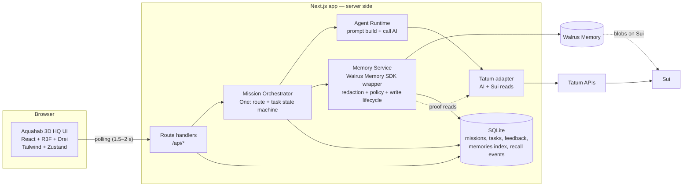
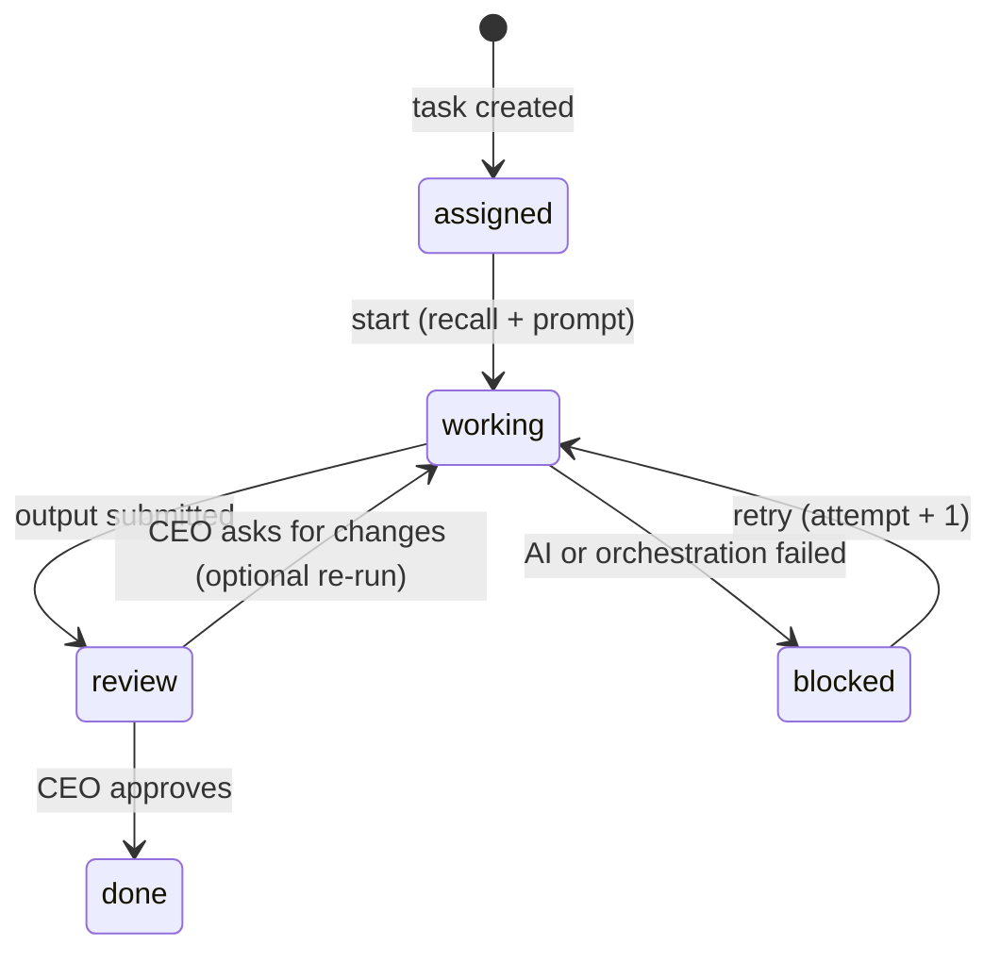
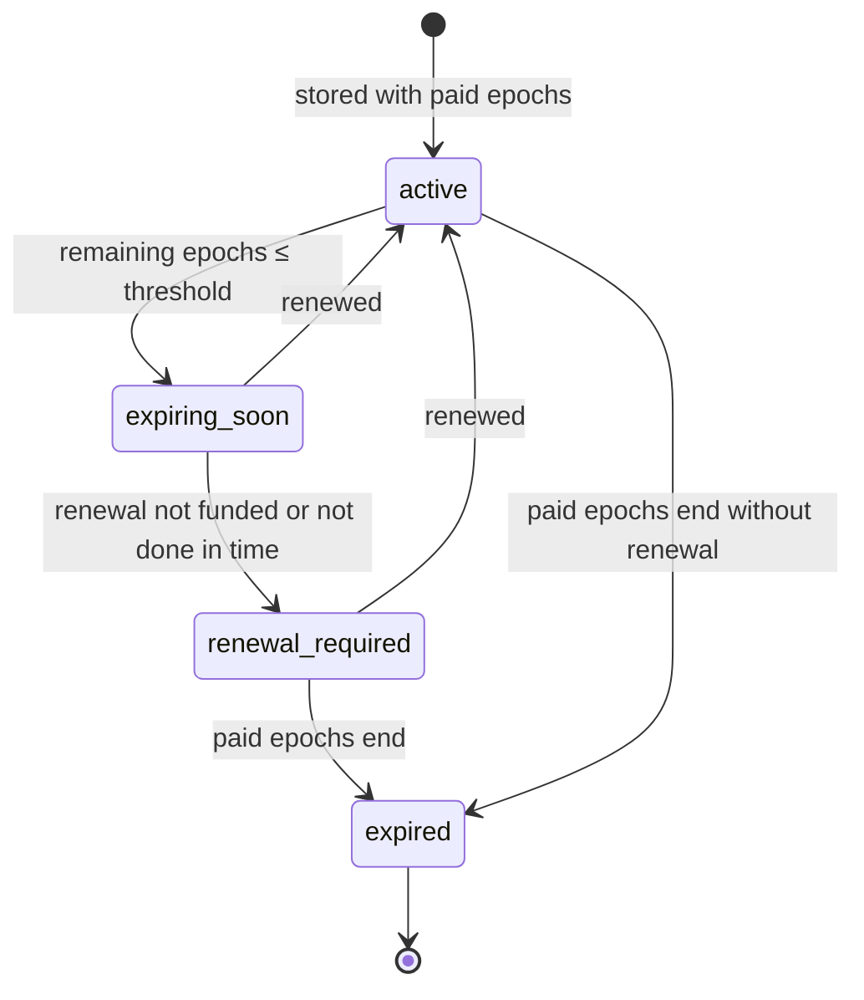
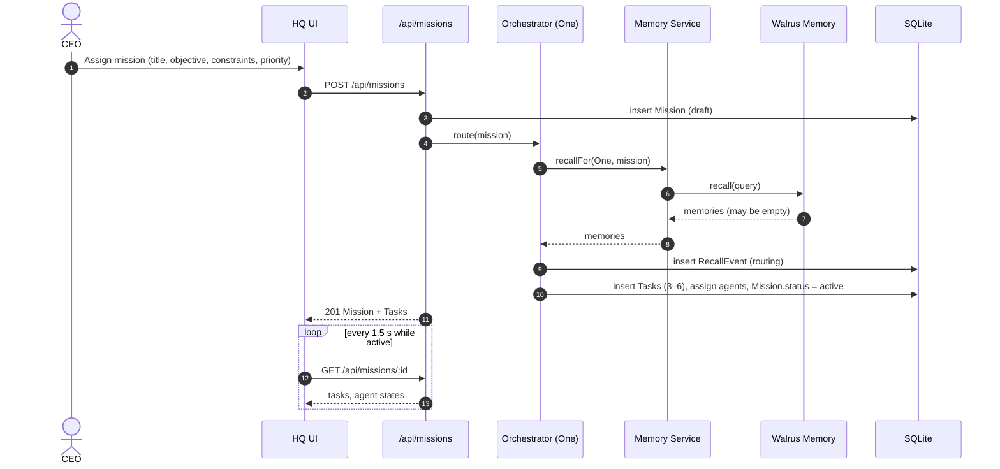
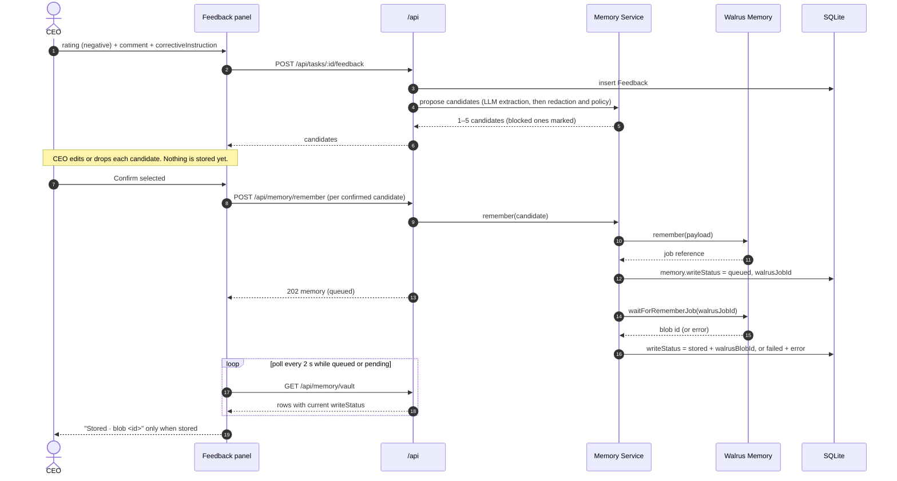

# Aquahab — System Design (MVP, Phase 1)

| Field | Value |
|---|---|
| Status | Draft v1.0 (aligned to `RESHADED_RE_SCAFFOLD_V1.md`) |
| Date | 2026-10-26 |
| Companion | `PRD.md`, `DATA_MODEL.md`, `API_DESIGN.md`, `docs/features/` |
| Source of truth | `PRODUCT_CONCEPT`, `RESHADED_RE_SCAFFOLD_V1.md`, `RESEARCH.md` |

Walrus Memory SDK methods used: **`remember`, `waitForRememberJob`, `recall`, `restore`, `health`, `listMemories`, `listNamespaces`**. `ask` is Phase 2 and not used in MVP (DECISIONS §8). `analyze` is not used by MVP routes (S+ v1.1). The set in RESHADED and CLAUDE.md is the source; the list here is what the SDK reference confirms. Anything not confirmed against the official reference is marked in §12.

---

## 1. Design Principles

1. **Memory is append-only and time-limited.** A stored memory cannot be edited. Corrections are new memories with `supersedesId`. A memory is "forgotten" by leaving the Vault and not being renewed; the blob lives until its paid epochs end. Every memory lasts only as long as its paid epochs (S+). The CEO confirms candidates before `remember` is called.
2. **Only the server talks to Walrus, Tatum, and Sui.** The browser holds no keys and makes no SDK calls.
3. **"Stored" means a blob id exists.** The UI shows stored only after `waitForRememberJob` resolves.
4. **Simple over distributed.** One app, one database, polling updates, tasks run in-process. RESHADED §E: "no distributed queue or multiplayer server."
5. **Failures are visible.** AI or Walrus failures show `blocked` or `retrying`. They never crash a page.
6. **Memory must change the next mission.** Every recall is recorded, so the UI can show which memories shaped which output.
7. **Phase 2 seam only.** Aqua City presence stays out of this design. Its state would never enter `MemoryService`.

---

## 2. High-Level Architecture

RESHADED §H, expanded with the chosen stack.



---

## 3. Stack

| Layer | Choice | Why |
|---|---|---|
| Web app and API | Next.js (React + TypeScript), route handlers for `/api/*` | RESHADED stack; one deployable; server code keeps keys private |
| 3D | React Three Fiber + Drei | RESHADED stack; reference projects use it |
| Client state | Zustand | RESHADED stack; holds view state only, not business state |
| Styling | Tailwind CSS | RESHADED stack |
| Memory | Walrus Memory TypeScript SDK | RESHADED stack |
| AI and chain data | Tatum APIs (chain data, Sui proof) and an LLM provider | RESHADED stack |
| Encryption | Seal, through the Walrus Memory encrypted flow | S+ privacy rules; plaintext never reaches Walrus |
| Memory backend | Hosted Walrus Memory relayer (`relayer.memory.walrus.xyz` on mainnet, `relayer-staging` on testnet), operator `MemWalAccount` and delegate key on the server | Custodial, no per-user account (S+ v1.1, MemWal cookbook) |
| Database | SQLite (single file) | No distributed state needed for MVP; survives refresh |
| Realtime | Polling | RESHADED §E |
| Tests | Vitest for services, Playwright for the demo script | Light, fast |

Demo cap per RESHADED §E: 1–10 CEOs, each with one company, 4–6 agents per company, 3–6 tasks per mission, 3–10 memories per mission, 5–8 templates.

---

## 4. Components

### 4.1 3D HQ UI

- One HQ scene: One at the center, four worker desks, the Walrus Keeper at the Memory Vault door.
- Panels (HTML over the scene): Mission Board, Desk panel, Memory Vault, Company Briefing, Feedback review.
- A 2D desk-grid fallback uses the same panels and data. It is switched by a flag if the scene is not ready.
- The UI polls and renders. It contains no memory policy.

Detailed specs: `docs/features/mission-board.md`, `agent-desk.md`, `memory-vault.md`, `feedback-loop.md`, `company-briefing.md`.

### 4.2 Mission Orchestrator (One, Chief of Staff)

| Step | Rule |
|---|---|
| Create mission | Validate, save, run routing recall, create 3–6 tasks, assign agents |
| Route | Tasks go to the lead role and supporting roles from the template (`DATA_MODEL.md` §2) |
| Execute | Tasks run one after another in-process. No queue service. |
| Track | Mission status: `active` → `review` when all tasks are `review`/`done` → `completed` when approved |
| Block | A failed task becomes `blocked` with a reason. The mission stays `active`; other tasks continue. |
| Retry | `blocked` task → `working`, `attempt + 1` |

State machines are defined in §5.

### 4.3 Agent Runtime

Follows RESHADED §D exactly:

0. Gate checks, in order: agent is enabled and not paused; task quota has room; permissions allow the task (`DECISIONS.md` §4–§5, `docs/features/agent-governance.md`). Any failure sets the task `blocked` with a reason, and no LLM call is made.
1. Receive task. Set task and agent to `working`.
2. If `runMode = memory_on` and `canReadCompanyMemory` is true, build a recall query from mission objective, task input, role, and constraints. Call `recall` with limit `min(5, maxRecallResults)`. Record a `RecallEvent`. On failure, record `skipped` and continue with empty context.
3. Build the prompt: role persona, mission, task input, constraints, a `Known from memory` section (if any), and the strategy and `skills.md` in a labeled block marked as configuration (`skillsVersion` recorded on the task).
4. Estimate the LLM cost. If it exceeds `perTaskLlmCapCents` or the remaining `llmBudgetCents`, set `blocked` with "Budget exhausted". Otherwise call the Aquahab-managed key through `LLMClient`, and debit the ledger. On failure, set `blocked`.
5. Return structured output. Set task and agent to `review`. If `canProposeMemory` is true, the runtime may propose candidates. It never calls `remember`.
6. Outcome validation (`DECISIONS.md` §3.1) runs after review. If every check passes, the orchestrator stores the outcome memory with `autoSaved: true`. Otherwise it records which check failed.

Prompt order is fixed so the before/after difference is attributable to memory only: persona → output contract → constraints → Known from memory → task → mission.

### 4.4 Memory Service

The only module that imports the Walrus Memory SDK. Exposes business operations:

| Operation | SDK method | Caller |
|---|---|---|
| `health()` | `health` | Status light, demo preflight |
| `recallFor(agent, mission, query)` | `recall` | Orchestrator, Runtime |
| `remember(candidate)` | `remember` | Feedback confirm |
| `settle(memory)` | `waitForRememberJob` | Background settle, retry |
| `restoreIndex()` | `restore` | Operator, when recall is empty for a company with memories |
| `briefing(company)` | `recall` over several namespaces, sorted by recent, then LLM summary (`analyze` is not used; S+ v1.1) | Company Briefing |
| `ask(company, question)` | `ask` | Phase 2 only (Vault "Ask", DECISIONS §8). Not in MVP. |
| `lifecycleFor(company)` | `listMemories` (reads `end_epoch`, `expires_at`, `status`); result cached in the index and refreshed on each Vault load | Vault, Briefing, recall filter |
| `renew(memories)` | `recall` for text, then `remember` with `renewedFromId` (rewrite strategy, plan D2). `extend_blob` is post-MVP. | Vault renew action, expiry banner |
| `forget(memory)` | none. Aquahab-level: removes from Vault and stops renewal | Vault "Forget" action |
| `quotaFor(company)` | `listNamespaces` (`memory_count`, `storage_used`) and rate-limit points tracked per delegate key | Vault quota meter, spending cap |

Internal rules:

- **Redaction first.** Credential patterns (API keys, tokens, private keys, seed phrases, `Authorization` headers, session cookies, `user:password` URLs) block a candidate before `remember`. The response reports the removed line, never the secret. Obvious personal identifiers (email, phone, ID numbers, home address) are flagged on the candidate, and kept only if the CEO explicitly chooses to keep them (S+).
- **Spending and volume caps.** `remember` checks the demo spending cap and the per-session memory cap before any Walrus call. Over the cap, it returns `DEMO_CAP_REACHED` (429) and writes nothing.
- **Local index holds ciphertext.** The SQLite index stores the encrypted content reference and metadata. Plaintext is decrypted on demand for the owner's session and is never logged or sent to other viewers. If the SDK requires plaintext for recall (A10), plaintext is held only in server memory for the request.
- **Policy.** Only the memory types in `DATA_MODEL.md` §3.1 are accepted. Ephemeral state is rejected here.
- **Write lifecycle.** `queued` → `pending` → `stored` | `failed` (`DATA_MODEL.md` §5). Retry uses the existing job id.
- **Index.** The SQLite `memories` table mirrors what was written. It is a cache for listing; Walrus is the record.
- **Scopes.** `agent`, `project`, `company`. Retrieval for a task reads the company scope, the mission's project scope, and the assigned agent's scope.

### 4.5 Tatum Adapter

| Use | Detail |
|---|---|
| AI | Every agent and briefing LLM call goes through `LLMClient` backed by the Aquahab-managed LLM key. Model set by config. |
| Sui proof | Read-only lookup of the Sui reference for a stored blob. Result cached on the memory row. |

No write path to Sui in MVP. Our code signs no Sui transactions; wallet and SDK flows handle owner signing (A10, A11). Exact endpoints are open item A6 in §13.

### 4.6 Database

SQLite file in the app's data directory. Tables and indexes: `DATA_MODEL.md` §7.

---

### 4.7 Agent Governance  **[DECISIONS.md §3–§7]**

| Concern | Design |
|---|---|
| Roster | Five fixed roles and desks. No create-agent route. |
| Activation | On-mission only. No scheduler, no cron, no background runs. |
| Control | CEO can enable, disable, pause, resume, edit strategy, and fund. |
| Budget | USD cents for LLM. Count and bytes for memory. Count for tasks and tools. Enforced in the runtime before each LLM, memory, task, or tool call. |
| Ledger | Append-only `BudgetLedgerEntry`. Refund is an `adjustment` entry. |
| Memory writes | Agents propose candidates. Only the orchestrator calls `remember()`. Preference, feedback, and decision need CEO approval. Outcome auto-stores after §3.1 validation. |
| Walrus permissions | None per agent. Delegate key is account-wide and server-side, so permissions are enforced in Aquahab. |
| Skills | `skills.md` is untrusted. 16 KB limit, redacted on save, versioned by hash, never stored as memory. |
| Auditability | Each task records `skillsVersion`, the budget debits, and the recall event. |

## 5. State Machines

### 5.1 Task (RESHADED §D)



"Retrying" in the UI is `working` with `attempt > 1`.

Re-run after feedback is optional in MVP. The required path is: feedback becomes memory, and the next mission uses it. The re-run shown in the demo is a convenience, not a requirement.

### 5.2 Mission

```mermaid
stateDiagram-v2
  [*] --> draft
  draft --> active: CEO assigns; tasks created
  active --> review: all tasks in review or done
  review --> completed: CEO approves
  review --> active: CEO requests changes
  active --> failed: unrecoverable (all retries exhausted)
  review --> failed: CEO rejects the mission
```



### 5.3 Agent

`idle` → `assigned` (task routed) → `working` (task started) → `review` (output ready) → `idle` (task done). `blocked` when its task is blocked. `offline` is reserved and not used in the demo.

---

### 5.4 Memory Lifecycle (S+)



Rules:
- Four lifecycle states only (DECISIONS.md §2). Renewal is manual; no automatic renewal in MVP.
- Recall returns only `active` and `expiring_soon` memories. `renewal_required` and `expired` are excluded.
- `expired` is shown in the Vault with its message. It is never hidden.
- "Forget" is not a state. The CEO sets `forgottenAt`, the memory leaves the Vault list, and renewal stops. The blob persists until its paid epochs end. Forgotten memories remain in export metadata.

## 6. Demo Design (before / after)

RESHADED §D: "Mission 1 → feedback → Mission 2 recalls memory." The design follows it exactly.

Walrus memory is append-only, so a demo cannot reset memory by deleting it. Two rules make the comparison honest:

1. **A demo run uses a fresh company.** Each rehearsal creates a new company with a new `memoryNamespace`. Its memory starts empty, so Mission 1 is a true "before". Earlier rehearsals stay in Walrus but do not touch this company.
2. **Mission 2 uses the same company, the same template, and a similar brief** after feedback is stored.

`runMode = memory_off` is kept as an optional control. It runs the same template with recall disabled, which gives a side-by-side comparison in the same company. The demo video uses the fresh-company flow.

Demo sequence (2–3 minute video):

1. Create a fresh demo company. Health check passes.
2. Mission 1: "Plan a Sui wallet launch for Vietnam." Researcher returns a long, hype-heavy brief. Vault shows nothing.
3. CEO feedback: "Too long. Focus on Vietnam. Use a concise technical tone with citations."
4. Candidates appear. CEO confirms. Vault shows `queued` → `pending` → `stored` with blob ids. Walrus Keeper animates on each stored memory.
5. Mission 2: "Write a launch brief for the Sui wallet." Researcher's desk shows "Recalled 3 memories", expandable. Output is short, Vietnam-focused, technical.
6. Vault: proof panel shows the blob id and the Sui reference. (Ask the Vault is Phase 2, DECISIONS §8.)

---

## 7. Sequence Diagrams

Updates reach the UI by polling (see the realtime note at the top of `API_DESIGN.md`). Each sequence shows the Walrus calls in order.

### 7.a CEO assigns a mission (RESHADED Main Flow steps 1–2)



### 7.b Agent recalls memory and completes a task (RESHADED Agent Runtime)

```mermaid
sequenceDiagram
  autonumber
  participant ORCH as Orchestrator
  participant RT as Agent Runtime (Researcher)
  participant MEM as Memory Service
  participant WAL as Walrus Memory
  participant AI as LLM provider (LLMClient)
  participant DB as SQLite
  participant UI as HQ UI (polling)

  ORCH->>DB: Task.status = working; Agent.status = working
  ORCH->>RT: run(task)

  alt runMode = memory_on
    RT->>MEM: recallFor(agent, mission, query)
    MEM->>WAL: recall(query, limit 5)
    alt recall succeeds
      WAL-->>MEM: 0–5 memories
      MEM-->>RT: memories
      RT->>DB: RecallEvent(memoryIds, latencyMs)
    else recall fails or times out
      WAL-->>MEM: error
      MEM-->>RT: []
      RT->>DB: RecallEvent(skipped, recall_failed)
    end
  else runMode = memory_off
    RT->>DB: RecallEvent(skipped, memory_off)
  end

  RT->>AI: prompt (persona, contract, constraints, Known from memory, task)
  alt AI succeeds
    AI-->>RT: structured output
    RT->>DB: Task.output, Task.status = review; Agent.status = review
  else AI fails
    AI-->>RT: error
    RT->>DB: Task.status = blocked, blockerReason
  end

  loop poll
    UI->>DB: GET /api/missions/:id (via API)
    DB-->>UI: task status, recall event: "Recalled N memories"
  end
```

### 7.c CEO gives feedback and memory is stored (RESHADED Memory Vault flow)



Failure: `writeStatus = failed`. Retry calls `POST /api/memory/:id/retry`, which calls `waitForRememberJob` with the existing job id. It never calls `remember` again.

---

## 8. Walrus Memory Integration

Official methods only. Argument shapes are confirmed against the API reference before implementation (open item A1). The placeholders below show the call sites, not the final signatures.

```ts
// Health. Status light and demo preflight.
const status = await walrus.health(/* confirm args */);

// Store. Returns a job reference. Does NOT mean stored.
const job = await walrus.remember(/* content, scope, type, ownerId, confidence — confirm shape */);

// Settle. The only place a blob id comes from.
const { blobId } = await walrus.waitForRememberJob(job.jobId /* confirm shape */);

// Retrieve. Before routing and before each task when memory is on.
const memories = await walrus.recall(/* query, scopes, limit: 5 — confirm shape */);

// Recover. Rebuild the local index when recall is empty for a company that has memories.
await walrus.restore(/* confirm args */);

// Synthesize. Company briefing.
// Not used for briefing (S+ v1.1). Briefing reads recall() and summarizes with LLM.
// analyze() writes extracted facts to memory; it is kept out of MVP routes unless the spike proves a use.
const facts = await walrus.analyze(/* text — confirm shape; writes memory */);

// Question. "Ask the Vault". Phase 2 only (DECISIONS §8). Not called in MVP.
const answer = await walrus.ask(/* question, company scope — confirm shape */);
```

### 8.1 Usage rules

| Rule | Reason |
|---|---|
| Stored only after `waitForRememberJob` returns a blob id | Honest UI; RESHADED "Memory not saved" path |
| No second `remember` for the same confirmed candidate | Walrus writes cannot be edited; a duplicate costs storage and clutters the Vault |
| Retry settles the existing job id | No duplicate write |
| Recall limit 5; the 3–5 result target in RESHADED §D | Keeps prompts short |
| Recall results are recorded as a `RecallEvent` before the prompt is built | Traceability |
| Run `health` at startup and at demo preflight | Catches configuration errors before the audience |
| Use `restore` only for recovery, not in normal flow | Restore rebuilds the index; it is not a sync |

### 8.2 Planned use of `analyze` and `ask`

RESHADED and the research name both methods but do not define their behavior. The planned use:

- **`analyze`:** per the SDK reference it extracts facts from a text and stores them as memories (job IDs and `facts[]` returned). It is **not** a summary tool. MVP does not use it for briefing. The Day 2 spike decides whether it has any MVP role (plan D5).
- **Briefing:** `recall` with `sort: "recent"` across the company's namespaces, then a LLM summary. Each briefing line keeps the memory IDs of the recall results it draws on, so the memory chips still work.
- **`ask` (Phase 2 only, DECISIONS §8):** input is the CEO's question scoped to the company; output is an answer with sources. "Not found" must be an explicit result.

Fallback when either lacks sources: `recall` for sources plus an LLM summary, labeled in the UI as "Summary generated from recent memory; source links unavailable."

---

## 9. Error Handling (RESHADED §D)

| Failure | Backend | UI | Recovery |
|---|---|---|---|
| AI fails | Task → `blocked`, reason stored | Task "Blocked" | Retry (`attempt + 1`) |
| `remember` / settle fails | Memory `writeStatus = failed` | "Memory not saved" | Retry (same job id) |
| `recall` fails | `RecallEvent.skipped`, empty context | Warning "Ran without memory" | Continue; re-run optional |
| Walrus unreachable | `health` returns not ok | Vault status light red; recall and remember show failures | Retry; demo blocked until `health` passes |
| Network fails | Client keeps last good state | Global banner | Retry; polling resumes |
| Unexpected error | Logged with ids, no content | Global banner | Retry |

Rule: no failure path shows an empty screen or crashes. Every failure has a visible label and a recovery action.

---

## 10. Security and Privacy

| Area | Design |
|---|---|
| Keys | Tatum and Walrus credentials in server environment only. `.env` git-ignored. Never in the client bundle. |
| Redaction | Before every `remember`, and before candidates are shown. Blocked lines are reported by position. |
| Logs | Record ids, statuses, timings. No memory content, no prompts, no secrets. |
| Access | One demo session cookie per company. No production auth (RESHADED non-goal). |
| Keys | The operator `MemWalAccount` owner key stays offline (used only for `addDelegateKey` and `removeDelegateKey`). The delegate key that writes memory lives in the server secret manager. No wallet is required from the CEO (S+ v1.1, custodial). |
| Chain | Read-only Sui proof through Tatum. |
| Input | All request bodies validated server-side. Comment length capped. |

---

### 10.1 Privacy and Ownership (S+)

| Rule | Design |
|---|---|
| Plaintext | Never uploaded to Walrus. Content goes through the Seal-encrypted memory flow. |
| Public metadata | Blob IDs, sizes, epochs, and proof links are public. The Vault labels them as public. |
| Owner | Blobs belong to the Aquahab operator `MemWalAccount` (custodial, S+ v1.1). The space key is operator account + `aquahab:{companyId}` prefix + scope. |
| Isolation | Enforced by the app, not by Walrus. The delegate key can read every namespace under the operator account (MemWal docs). Every API route checks `companyId` against the session. |
| Agents | Namespaces inside the company. They own no memories and act only through the company's delegate key. |
| Decrypt | The operator's delegate key decrypts for the server. The CEO never holds a Seal key. Relayer sees plaintext on the default path (MemWal docs). |
| Export | Metadata only (ids, types, scopes, dates, sizes, endEpoch, expiresAt, renewal state). Plaintext only on explicit owner request, logged. |
| Revoke | App-level: disable an agent's recall. Removing the delegate key revokes the whole server, not one agent, so per-agent keys are post-MVP. |
| Recovery | The company is tied to the app session. If the app loses its operator key, the operator uses `removeDelegateKey` and `addDelegateKey` (MemWal recovery path). CEO-level recovery depends on the app's sign-in, not on a wallet. |
| Trust | Users must accept that Aquahab runs the operator account (disclosure in onboarding). Self-custody is the post-MVP path (own `MemWalAccount` per CEO). |

## 11. Phase 2 Seam (not built)

Aqua City needs presence, shared positions, and chat. Those stay ephemeral. A later presence module would sit beside the orchestrator and never call the Memory Service. Public Vault views would reuse `GET /api/memory/vault` with a visibility filter. None of this is in the MVP.

---

## 12. Testing (hackathon scale)

| Test | Type | Pass condition |
|---|---|---|
| Walrus round trip | Integration (Day 2 spike) | A memory stored in one process is recalled in another |
| `health` at boot | Integration | Returns ok, or the UI shows the failure |
| Stored invariant | Unit | `stored` without `walrusBlobId` cannot be written |
| Redaction | Unit with fixtures | Every fixture is blocked; the secret is absent from DB, logs, responses |
| Memory OFF prompt | Unit | No `recall` call; no memory section in the prompt |
| Memory ON prompt | Unit | Recalled memory text is in the prompt; `RecallEvent` is written |
| Retry idempotency | Unit with mock SDK | Retry never calls `remember` |
| Recall latency | Integration | p95 under 5 seconds on the demo network (target 3–5 s) |
| Demo script | E2E | Three clean runs from a fresh company (PRD §9) |

---

## 13. Open Verification Items

| # | Item | Needed for | Action |
|---|---|---|---|
| A1 | Exact arguments and returns of `remember`, `waitForRememberJob`, `recall`, `analyze`, `ask`, `restore`, `health` | §8 | Read the Walrus Memory SDK usage and API reference, Day 1 |
| A2 | Native scope or namespace option | §4.4, `DATA_MODEL.md` D2 | API reference; fall back to payload fields |
| A3 | Write latency, `remember` to blob id | Demo pacing | Day 2 spike |
| A4 | Client account or auth setup | Judge setup | Official setup; document in README |
| A5 | LLM provider and model (Tatum is not an LLM) | `LLMClient` | Tatum API reference |
| A6 | Sui read path for a blob through Tatum | Proof panel | Tatum Sui gRPC guide |
| A8 | Network and epoch length (Testnet about 1 day, Mainnet about 2 weeks) | Storage duration, cost | Decide Day 1; PRD A8 |
| A9 | Storage funding source and demo budget | Spending cap, renewal | Product/infra owner, Day 1 |
| A10 | Seal encrypted memory flow; whether recall and ask work on ciphertext | §4.4, Vault display | SDK reference, Day 1 |
| A11 | Renewal and delegate methods in the SDK. Confirmed: no TS renew or extend; add and remove delegate exist (owner only). | Renewal action, revoke | `rewrite` strategy for MVP (plan D2); `extend_blob` post-MVP |
| A12 | Epoch default in practice (repo says 3 mainnet / 5 testnet; docs elsewhere say 50 / 2) | Retention window | Measure with `listMemories` after one `remember` on Day 2 |
| A13 | Hosted relayer quotas and rate limits (self-host defaults: 60 points/min, 500/hour, 1 GB per account) | Quota meter, batch sizing | Read 429 responses and `listNamespaces` on Day 2 |
| A14 | `ask` availability (SDK TS has no `ask`; relayer `POST /api/ask`; Python SDK has `ask`). Phase 2 only. | Vault Ask (Phase 2) | Day 1 check of installed SDK version; fall back to `recall` + LLM with sources |
